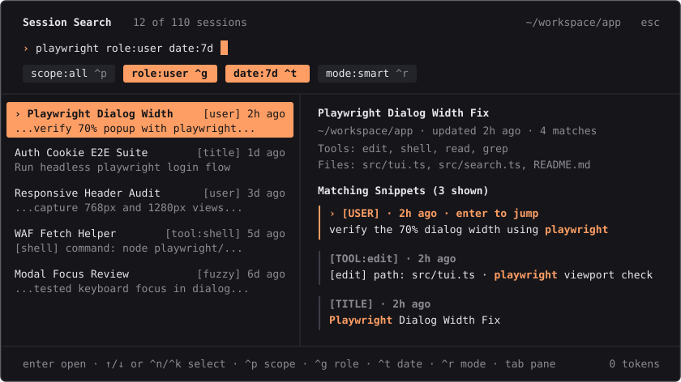

# opencode-session-search

Interactive TUI popup plugin for OpenCode to search past sessions, preview matching messages and files, and jump straight to the exact matched message in any conversation with zero token usage.



## Background

This project started as a small local CLI script wired to a custom `/search` command. It queried OpenCode's SQLite database and printed matching session IDs into the chat, which worked as a quick prototype but had two limitations in daily use:

1. **Every search ran through an LLM turn**: Because custom markdown commands send their output to the model, searching past sessions took several seconds and used prompt and completion tokens just to look up an old conversation.
2. **Results were static text**: Getting a list of session IDs in the chat still meant copying an ID or opening `/sessions` to actually switch to the session.

We wanted session search to work as a native part of the terminal interface: type `/search`, filter across your past work in real time, preview the exact message or file match on the right, and press `Enter` to open the session at that exact message.

## Design Goals

- **Zero token usage**: Searching local history is a navigation action. The plugin queries your local SQLite database directly inside the TUI without making an LLM request.
- **Zero setup and zero external dependencies**: Uses the SQLite driver built into OpenCode's runtime (`bun:sqlite` or `node:sqlite`) and a built-in bounded Levenshtein matcher, so there are no native addons or extra packages to install.
- **Works across OpenCode V2 and V1**: Automatically detects and indexes both the OpenCode V2 schema (`session_v2` and `session_message`) and the V1 schema (`session`, `message`, and `part`).
- **Fast, forgiving search**: Supports multi-word session-level AND matching, exact phrases, regular expressions, typo-tolerant fuzzy matching, and inline filters for role, date, file path, tool name, and project scope.
- **Jump to the exact message**: Opening a session from a search hit takes you straight to the message that matched instead of the bottom of the transcript.

## Highlights

- **Live Split-Pane Popup**: Filter sessions on every keystroke on the left while inspecting highlighted message snippets, tools used, and files touched on the right.
- **Auto-Scroll to Matched Message**: Press `Enter` to open the selected session and automatically scroll the transcript to the active matching message. Press `Tab` to focus the right preview pane and use `Up`/`Down` (or click any snippet card directly) to jump to a specific match inside that session.
- **Session-Level AND Matching**: Search for `auth cookie` to find sessions where both terms appear anywhere across the session title, user prompts, assistant replies, tool calls, or file paths, with single-message matches ranked higher.
- **Interactive Filter Pills**: Toggle project scope, message author, date range, and search mode with keyboard shortcuts or a single click, or type filters inline (`role:user`, `date:7d`, `file:tui.ts`, `tool:edit`).

## Installation

### Option 1: One-Command Install (Recommended)

```sh
opencode plugin add opencode-session-search
# or directly from GitHub:
opencode plugin add github:nandoblanco/opencode-session-search
```

### Option 2: Manual Config (`cli.json`)

Add `opencode-session-search` to `~/.config/opencode/cli.json` (or `$XDG_CONFIG_HOME/opencode/cli.json`):

```json
{
  "plugins": ["opencode-session-search"]
}
```

### From a Local Directory

Clone or copy this folder and reference it in `~/.config/opencode/cli.json` (no `npm install` or build step required):

```json
{
  "plugins": ["file:///path/to/session-search"]
}
```

## Usage

Open the search popup in any of three ways:

1. **Slash command**: Run `/search` to open the popup, or `/search <query>` (for example `/search playwright` or `/search file:tui.ts`) to open with your search pre-filled.
2. **Command palette**: Press `Ctrl+P` and select `Search session history...`.
3. **Custom keybind**: Bind `session.history.search` in `~/.config/opencode/cli.json`:

```json
{
  "keybinds": {
    "session.history.search": "ctrl+f"
  }
}
```

## Query Syntax

Type filters in the search bar or toggle them with keyboard shortcuts and clickable filter pills.

| Syntax | Description | Example |
| :--- | :--- | :--- |
| `term1 term2` | Session-level AND across title, messages, tools, and files (single-message hits rank higher) | `auth cookie` |
| `"exact phrase"` | Exact substring phrase match | `"session_message"` |
| `~term` | Typo-tolerant fuzzy match (bounded Levenshtein distance) | `~playwrigth` |
| `/pattern/i` or `re:pattern` | Regular expression match | `/error\s+\d+/i` |
| `role:user` / `role:assistant` / `role:shell` | Filter by message author (`from:user`, `from:ai` also work) | `role:user backup` |
| `scope:project` / `scope:all` | Filter to current workspace directory or all workspaces | `scope:project` |
| `date:today` / `date:yesterday` / `date:7d` / `date:30d` | Relative date filter | `date:7d migration` |
| `date:YYYY-MM` or `date:YYYY-MM-DD..YYYY-MM-DD` | Month or date range filter | `date:2026-10` |
| `file:<path>` | Filter sessions that read or modified a matching file path | `file:tui.ts` |
| `tool:<name>` | Filter sessions that invoked a matching tool | `tool:edit` |
| `in:title` / `in:message` / `in:tool` / `in:file` | Restrict search to a specific entry type | `in:title plugin` |

## Keyboard Shortcuts Inside the Popup

| Key | Action |
| :--- | :--- |
| `Enter` | Open the selected session and auto-scroll to the active matched snippet |
| `Up` / `Down` or `Ctrl+N` / `Ctrl+K` | Move selection up or down (or cycle matching snippets when the preview pane is focused) |
| `PageUp` / `PageDown` or `Ctrl+U` / `Ctrl+D` | Jump 6 items (or scroll preview pane when focused) |
| `Tab` / `Shift+Tab` | Switch focus between Search Input, Session List, and Preview Pane |
| `Ctrl+P` | Toggle project scope (`scope:all` vs `scope:project`) |
| `Ctrl+G` | Cycle role filter (`all`, `user`, `assistant`, `shell`) |
| `Ctrl+T` | Cycle date filter (`all`, `today`, `yesterday`, `7d`, `30d`) |
| `Ctrl+R` | Cycle search mode (`smart`, `fuzzy`, `regex`) |
| `Ctrl+L` | Force refresh the SQLite session index |
| `Esc` | Close popup |

## How It Works (Architecture & Internals)

### 1. Zero-Dependency Native SQLite Driver (`openReadOnlyDb` & `resolveDbPath`)

`opencode-session-search` has zero runtime npm dependencies and requires no compiled C++ addons. When the popup opens, `openReadOnlyDb()` detects the active JavaScript runtime (`Bun` vs. Node.js) and dynamically imports the built-in SQLite driver (`bun:sqlite` or `node:sqlite`) in read-only mode.

`resolveDbPath()` locates the OpenCode database in this order:

1. Explicit `customPath` argument (used by tests or custom callers)
2. `OPENCODE_DB_PATH` environment variable
3. `$XDG_DATA_HOME/opencode/opencode.db`
4. `~/.local/share/opencode/opencode.db` (macOS, Linux, Windows)
5. `%LOCALAPPDATA%/opencode/opencode.db` (Windows fallback)

Once loaded, `loadSessionIndex()` caches the parsed `SessionIndex` in memory for 6 seconds (`INDEX_TTL_MS = 6000`) so typing in the search bar filters in sub-millisecond time without re-querying SQLite on every keystroke (`Ctrl+L` forces an immediate re-index).

### 2. Dual-Schema Indexing (OpenCode V2 + V1 Fallback)

At index time, `loadSessionIndex()` inspects `sqlite_master` to support both OpenCode database generations automatically:

- **OpenCode V2 (`session_v2` + `session_message`)**:
  - Inspects `PRAGMA table_info(session_v2)` to resolve workspace directory columns (`directory` or `COALESCE(workspace_directory, root_directory, '')`) and exclude archived sessions (`WHERE time_archived IS NULL`).
  - Loads the 800 most recently updated sessions and uses a window function (`ROW_NUMBER() OVER (PARTITION BY m.session_id ORDER BY m.time_created DESC)`) to pull up to the latest 250 messages per session (`LIMIT 30000`, with a plain `ORDER BY` fallback if window functions are unavailable).
- **OpenCode V1 Fallback (`session` + `message` + `part`)**:
  - Automatically falls back to joining `part` and `message` (`json_extract(m.data, '$.role')`) if `session_v2` is not present.
- **Structured entry extraction**:
  - The indexer splits each message JSON payload into three `SearchEntry` kinds:
    - `message`: User prompt text and assistant reply text parts
    - `tool`: Tool invocations (`[toolName] key: value · ...` via `stringifyToolInput()`) and shell commands plus terminal output (`$ command\noutput`)
    - `filepath`: Attached user files, patch file lists, and file paths extracted from tool arguments (`path`, `filePath`, `file`, `file_path`, `targetFile`, `workdir`, `directory`, `files` via `extractFilePathsFromInput()`)

### 3. Query Parser & Session-Level AND Ranking (`parseSearchQuery` & `searchSessionIndex`)

`parseSearchQuery()` tokenizes raw input with `/(\/[^/]+\/[gimsuy]*|[a-zA-Z]+:"[^"]+"|"[^"]+"|\S+)/g`, separating inline filter tokens (`role:`, `scope:`, `date:`, `file:`, `tool:`, `in:`, `re:`, `~fuzzy`) from search terms and quoted phrases.

When filtering sessions, `searchSessionIndex()` enforces **session-level multi-term AND matching**: every required term in `terms` and `fuzzyTerms` must appear somewhere in the session, even if one term is in the session title, another is in a user prompt, and a third is in an edited file path. `searchSessionIndex()` scores matching sessions with fixed weights:

| Signal | Score Contribution | Notes |
| :--- | :--- | :--- |
| Title regex match | `+120` | When searching in `regex` mode (`/pattern/i` or `re:`) |
| Title exact substring match | `+90` | Per query term matched in `session.title` |
| Title fuzzy match | `+65 - (distance * 10)` | Explicit `~term` (`+55 - distance * 10` in `fuzzy` mode) |
| Entry exact match | `+35 * entryMatchedTerms` | Per message, tool call, or file path entry (`+50` / `+35` in `regex` mode) |
| Entry fuzzy match | `+20 * entryMatchedTerms` | When matched via bounded Levenshtein distance |
| Single-message co-occurrence bonus | `+45` | Added when a single message contains **all** query terms |
| Active `file:` / `tool:` target bonus | `+25` | Added when an entry directly matches the active `file:` or `tool:` filter |
| Recency boost | `max(0, 15 - recencyDays * 0.4)` | Breaks ties in favor of recently updated sessions |

### 4. Zero-Dependency Typo Tolerance (`editDistanceBounded` & `findFuzzyWordMatch`)

`src/search.ts` implements a bounded Levenshtein dynamic programming matcher (`editDistanceBounded(a, b, maxDist)`) for typo tolerance:

- Uses two rolling row arrays (`prev` and `curr`) and aborts immediately if length difference exceeds `maxDist` or if the minimum value in the current DP row exceeds `maxDist`.
- Allows edit distance `<= 1` for short words (3 to 5 characters) and `<= 2` for longer words (6+ characters), pre-filtering candidate tokens by a shared 2-character prefix or length within `maxDist`.
- **Automatic Smart Fallback**: In default `smart` mode, if a multi-word query fails the strict session-level AND check because one word has a typo (for example, `playwrigth`), `searchSessionIndex()` automatically retries the missing term through `findFuzzyWordMatch()` (`+30` title / `+22` entry) and tags the resulting snippet as `[FUZZY]`.

### 5. Auto-Scroll to the Exact Matched Message (`scrollToMatchedMessage`)

When you press `Enter` on a session (or click a specific snippet card in the right preview pane), the plugin navigates to that session (`context.ui.router.navigate({ type: "session", sessionID })`) and runs `scrollToMatchedMessage()` to scroll the transcript to the matched message:

1. **Message store sync**: Triggers `context.data.session.message.sync(sessionId)` and polls the live `@opentui` render tree every 60ms (up to 25 attempts) while the session view mounts.
2. **Viewport discovery**: Traverses `context.renderer.root` to find the largest visible `ScrollBoxRenderable` representing the conversation transcript.
3. **Three-tier node resolution**:
   - **Tier 1 (Exact ID)**: Matches a render node whose `id` equals or contains the target `messageId`.
   - **Tier 2 (Tiered text needles + chronological ratio)**: Walks `scrollBox.content` and compares `extractRenderableText(node)` against progressively broader normalized snippet needles. If multiple nodes match the same text, it computes the message's chronological index ratio (`msgIdx / (liveMessages.length - 1)`) and picks the candidate whose vertical position (`relY`) is closest to `ratio`.
   - **Tier 3 (Collapsed tool fallback)**: If the match was inside a collapsed tool call output, falls back after 6 attempts to scrolling to `topChildren[Math.round(ratio * (topChildren.length - 1))]`.
4. **Viewport positioning & scroll lock**: Scrolls the matched node to 22% from the top of the viewport (`scrollBox.scrollBy({ x: 0, y: dy })`), sets `scrollBox._hasManualScroll = true` so OpenCode's auto-scroll-to-bottom does not snap back, and re-applies the offset after 120ms to settle layout reflows.

## License

MIT
